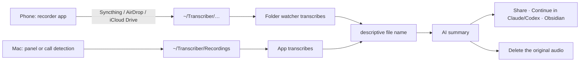

# Workflow: from conversation to result

Deutsch: [docs/de/ARBEITSABLAUF.md](de/ARBEITSABLAUF.md)

How the parts of Local Transcriber fit together, from recording (on your phone or on the Mac) to sharing the results.
Each feature is explained in the [user guide](USER_GUIDE.md).



**Part of Local Transcriber:** folder watcher, recording and call detection, descriptive file names, AI summary,
sharing, MCP server and Obsidian plugin. **Not part of it:** the recorder app on your phone and the way to the Mac
(Syncthing, AirDrop, iCloud Drive) – you set that up yourself; below is how it works well.

## 1. Record

### On the Mac

- **Panel › Start recording:** microphone and system audio (the others in a call) as two tracks, saved to
  `~/Transcriber/Recordings` as `Recording YYYY-MM-DD HH-MM.m4a`. The app transcribes it itself.
- **Call detection:** when Teams, Zoom, Meet in the browser, FaceTime, Slack & co. use the microphone, a notification
  asks “Record?” – recording starts only when you click. It ends with the call.
- **Calendar:** the current event provides title and participants (speaker count, name suggestions).

### On an Android phone

Most convenient with [Syncthing](https://syncthing.net): it mirrors the phone's recording folder straight into a
subfolder of `~/Transcriber`, no cloud involved.

1. **A recorder app** that saves to a regular folder, e.g. the open-source *Fossify Voice Recorder*. Apps that keep
   recordings internally work via *Share* or *Export* into that folder.
2. **File name** `Recording YYYY-MM-DD HH-MM` or `Aufnahme YYYY-MM-DD HH-MM` (seconds after it are fine); in Fossify
   the pattern `Recording %Y-%M-%D %h-%m %s`. Only files with this default name are later given a descriptive name –
   others keep theirs.
3. **Syncthing:** share the phone's recording folder with the Mac and put it at `~/Transcriber/Phone` there (any
   subfolder works **except** `Recordings`/`Aufnahmen` – that one belongs to the app).
   - Folder type **“Send & Receive”** on both sides if deleting on the Mac should also remove the recording on the phone
     (see section 6). With “Send Only” on the phone, recordings stay there.
   - Add Transcriber's working files to the folder's `.stignore` so they don't travel back and forth:
     ```
     *.lock
     *.tmp
     *.tmp.wav
     (?d).DS_Store
     ```
4. **Turn on the folder watcher** (the installer offers it; with Homebrew, run the curl installer once). It checks
   `~/Transcriber` and its subfolders every 5 seconds and waits until a file has been unchanged for 10 seconds – it
   leaves half-transferred files and Syncthing's hidden temporary files alone.

### On an iPhone

Via **iCloud Drive and a shortcut**. The recording only sits in iCloud briefly, until the Mac picks it up.

1. On the Mac: turn on **Settings › Recording › iPhone › “Fetch recordings from iPhone via iCloud Drive”** (iCloud
   Drive must be on, iPhone and Mac signed in with the same Apple Account).
2. Below it, scan the QR code with the iPhone camera or choose **Send via AirDrop …**, then tap **Add Shortcut** on the
   iPhone. The shortcut *Send to Transcriber* then appears in the share sheet. It gives the recording the standard
   name `Recording YYYY-MM-DD HH-MM` (date of the recording) and saves it without asking to
   *iCloud Drive › Shortcuts › Transcriber*. The file is also on the website.
3. Day to day: record in *Voice Memos* (or another recording app) › **Share** › **Send to Transcriber**.
4. The app moves the recording to `~/Transcriber/iPhone`, the folder watcher transcribes it, then the descriptive name
   and summary follow. No copy stays in iCloud; the recording in *Voice Memos* is kept. If the Mac is off, the file
   waits in iCloud until the app starts next time.

Anything that lands in *iCloud Drive › Transcriber* (e.g. via *Share › Save to Files*) is picked up the same way, but
without the standard name and therefore without a descriptive name.

**Privacy:** Without *Advanced Data Protection* for iCloud, Apple holds the keys to iCloud Drive. For confidential
conversations, turn it on or use AirDrop.

**No cloud: AirDrop.** Recording › *Share* › *AirDrop* › tap the Mac (iPhone nearby, Mac awake). Like every AirDrop
file, it lands in `~/Downloads`. With **Settings › Recording › iPhone › “Take over recordings received via AirDrop”**
the app moves it from there to `~/Transcriber/iPhone`. Only audio files that arrive via AirDrop, and only those
arriving after you turn it on, are picked up; everything else in Downloads is left alone. Voice Memos default names
(“New Recording 3”) become `Recording YYYY-MM-DD HH-MM`. macOS asks once for access to the “Downloads” folder when you
turn it on. Without the setting: drag the file from Downloads onto the panel or choose **Transcribe file…**.

### Dictation

A third entry point, separate from this chain: **hold right ⌘**, speak, release – the text appears at the cursor in
any app. **Right ⌥** tidies it up with Apple Intelligence first. No transcript and no summary are created.

## 2. Transcribe

Next to the audio file you get `<name>.txt` (or `.md`, Settings › Recording) and `<name>.transcript.json`, with
speakers recognized from the local voice database. Only one transcription runs at a time; others wait. A failure is
written to `<name>.error.txt`.

## 3. Descriptive file name

When a transcription with a default name finishes, Apple Intelligence (on device, macOS 26) turns the content into a
title: `Recording 2026-10-23 22-52` becomes e.g. `2026-10-23 22-52 Budget planning Q4`. Audio, transcript and
companion files are renamed together. For Mac recordings made during a calendar event, the event title wins.

**Only while the app is running** when the transcription finishes – it renames nothing afterwards. For phone
recordings that arrive overnight, turn on **Settings › General › Open at login**.

## 4. Summarize with AI (optional)

**Settings › AI:** set up a model and **“Summarize automatically after each transcription”** with a template (minutes,
short summary, five-paragraph order, supervision and coaching note, key statements, follow-up email, or your own).
The automation runs after the descriptive name and also only while the app is running. Result: `<name>.summary.md`
next to the transcript; without the automation, **Summarize** on the entry in the panel.

- **Local** (Ollama, LM Studio, MTPLX or a custom address): nothing leaves the Mac.
- **Cloud** (OpenAI, Anthropic, Mistral, OpenRouter, your own key): by default only on click, never automatically.
  Participants' names are replaced by placeholders before sending and put back on the Mac.

## 5. Share

On the entry in the panel: **Open · Copy · Share · ⋯**

- **Share:** the macOS share menu – Mail with subject and formatted text (tasks as ☐), Messages, Notes, AirDrop … In the
  ⋯ menu, **Share as file …** attaches the `.summary.md`.
- **Continue in** (⋯ menu, when installed): **Claude** receives the summary as text; **Claude Code** and **Codex** open
  in the recording's folder and read summary and transcript themselves.
- **MCP server** for AI agents: find and read transcripts, fetch or create summaries, name speakers, maintain the
  glossary; the templates are available as prompts (e.g. `/protokoll`). Setup:
  - Claude Code: `claude mcp add --scope user transcriber -- ~/.local/share/transcriber/venvs/app/bin/transcriber-mcp`
  - Claude Desktop: add `"transcriber": {"command": "/Users/<you>/.local/share/transcriber/venvs/app/bin/transcriber-mcp"}`
    under `mcpServers` in `~/Library/Application Support/Claude/claude_desktop_config.json`, restart Claude.
- **Obsidian:** the plugin *Local Transcriber for Obsidian* (0.2.0 or later) turns each transcript into a note, with
  the summary as its own section above it and tasks to tick off.

## 6. Clean up: delete the original audio

Once a conversation has been processed, the recording is usually no longer needed – and for confidential conversations
it should then not be lying around anywhere.

- **Trash icon** on the entry in the panel: **Recording only** (audio and internal copies go; transcript, summary and
  voices stay) or **Delete everything**. Visible files go to the Mac's Trash. Older conversations you delete the
  same way in the window **All transcripts** (“All” in the panel); deleted in the Finder, Transcriber cleans up its
  copies within a few minutes.
- **Automatically:** Settings › Recording › “Delete audio after 30 days (transcripts stay)”: all transcribed audio and
  video files in `~/Transcriber` and its subfolders, phone folders included, 30 days after transcription.
- **On the phone:** with Syncthing and “Send & Receive”, deleting on the Mac removes the file on the phone too (Syncthing
  does that, not Transcriber). With AirDrop and the shortcut, the original stays on the iPhone (e.g. in *Voice Memos*); delete it there yourself.
- Until the Trash is emptied (and as long as Syncthing versioning keeps it), the file still exists.
