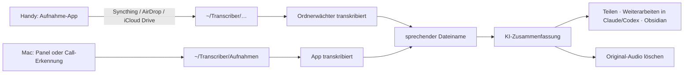

# Arbeitsablauf: vom Gespräch zum Ergebnis

English: [WORKFLOW.md](../WORKFLOW.md)

So greifen die Teile von Local Transcriber ineinander, von der Aufnahme (am Handy oder am Mac) bis zur Weitergabe
der Ergebnisse. Die einzelnen Funktionen erklärt die [Anleitung](ANLEITUNG.md).



**Teil von Local Transcriber** sind Ordnerwächter, Aufnahme und Call-Erkennung, sprechende Dateinamen,
KI-Zusammenfassung, Teilen, MCP-Server und Obsidian-Plugin. **Nicht dazu gehören** die Aufnahme-App am Handy und der
Weg aufs MacBook (Syncthing, AirDrop, iCloud Drive) – das richtest du selbst ein; unten steht, wie es gut funktioniert.

## 1. Aufnehmen

### Am Mac

- **Panel › Aufnahme starten:** Mikrofon und Systemton (die anderen im Call) als zwei Spuren, Ablage in
  `~/Transcriber/Aufnahmen` als `Aufnahme JJJJ-MM-TT HH-MM.m4a`. Die App transkribiert selbst.
- **Call-Erkennung:** Nutzt Teams, Zoom, Meet im Browser, FaceTime, Slack & Co. das Mikrofon, fragt eine Mitteilung
  „Aufnehmen?“ – aufgenommen wird nur auf Klick. Die Aufnahme endet mit dem Call.
- **Kalender:** Der laufende Termin liefert Titel und Teilnehmende (Sprecherzahl, Namensvorschläge).

### Am Handy (Android)

Am bequemsten mit [Syncthing](https://syncthing.net): Es spiegelt den Aufnahmeordner des Handys direkt in einen
Unterordner von `~/Transcriber`, ohne Cloud.

1. **Aufnahme-App,** die in einen normalen Ordner speichert, z. B. der quelloffene *Fossify Voice Recorder*. Apps,
   die ihre Aufnahmen nur intern halten, gehen über *Teilen* bzw. *Exportieren* in diesen Ordner.
2. **Dateiname** `Aufnahme JJJJ-MM-TT HH-MM` (Sekunden dahinter erlaubt), in Fossify das Muster
   `Aufnahme %Y-%M-%D %h-%m %s`. Nur Dateien mit diesem Standardnamen benennt die App später sprechend um – andere
   behalten ihren Namen.
3. **Syncthing:** den Aufnahmeordner des Handys mit dem Mac teilen und dort als `~/Transcriber/Handy` anlegen
   (jeder Unterordner geht, **nur nicht** `Aufnahmen` – der gehört der App).
   - Ordnertyp **„Senden & Empfangen“** auf beiden Seiten, wenn ein Löschen am Mac auch die Aufnahme am Handy
     entfernen soll (siehe Abschnitt 5). Mit „Nur Senden“ am Handy bleiben die Aufnahmen dort liegen.
   - In die `.stignore` des Ordners gehören die Arbeitsdateien des Transcribers, damit sie nicht hin- und herwandern:
     ```
     *.lock
     *.tmp
     *.tmp.wav
     (?d).DS_Store
     ```
4. **Ordnerwächter** einschalten (der Installer bietet ihn an; mit Homebrew einmal den curl-Installer ausführen). Er
   prüft `~/Transcriber` samt Unterordnern alle 5 Sekunden und wartet, bis eine Datei 10 Sekunden lang unverändert
   ist – halb übertragene Dateien und die versteckten Zwischendateien von Syncthing fasst er nicht an.

### Am Handy (iPhone)

Über **iCloud Drive und einen Kurzbefehl**. Die Aufnahme liegt nur kurz in iCloud, bis der Mac sie abholt.

1. Am Mac: **Einstellungen › Aufnahme › iPhone › „Aufnahmen vom iPhone aus iCloud Drive holen“** einschalten
   (iCloud Drive muss an sein, iPhone und Mac mit derselben Apple-ID).
2. Darunter den QR-Code mit der Kamera des iPhones scannen oder **Per AirDrop senden …** wählen, dann am iPhone
   **Kurzbefehl hinzufügen**. Der Kurzbefehl *An Transcriber senden* steht danach im Teilen-Menü. Er gibt der
   Aufnahme den Standardnamen `Aufnahme JJJJ-MM-TT HH-MM` (Datum der Aufnahme) und sichert sie ohne Rückfrage in
   *iCloud Drive › Kurzbefehle › Transcriber*. Die Datei gibt es auch auf der Website.
3. Im Alltag: in *Sprachmemos* (oder einer anderen Aufnahme-App) aufnehmen › **Teilen** › **An Transcriber senden**.
4. Die App verschiebt die Aufnahme nach `~/Transcriber/iPhone`, der Ordnerwächter transkribiert, danach folgen
   sprechender Name und Zusammenfassung. In iCloud bleibt keine Kopie, die Aufnahme in *Sprachmemos* bleibt
   erhalten. Ist der Mac aus, wartet die Datei in iCloud bis zum nächsten Start der App.

Was in *iCloud Drive › Transcriber* landet (z. B. über *Teilen › In Dateien sichern*), holt die App genauso ab, nur
ohne Standardnamen und damit ohne sprechenden Namen.

**Datenschutz:** Ohne *Erweiterten Datenschutz* für iCloud hält Apple die Schlüssel zu iCloud Drive. Für vertrauliche
Gespräche diesen einschalten oder AirDrop nehmen.

**Ohne Cloud: AirDrop.** Aufnahme › *Teilen* › *AirDrop* › den Mac antippen (iPhone in der Nähe, Mac wach). Die Datei
landet wie jede AirDrop-Datei in `~/Downloads`. Mit **Einstellungen › Aufnahme › iPhone › „Per AirDrop empfangene
Aufnahmen übernehmen“** holt die App sie von dort nach `~/Transcriber/iPhone`. Erkannt werden nur Audiodateien, die
per AirDrop ankommen, und nur solche, die nach dem Einschalten eintreffen; alles andere in Downloads bleibt unberührt.
Vorgabenamen von Sprachmemos („Neue Aufnahme 3“) werden dabei zu `Aufnahme JJJJ-MM-TT HH-MM`. macOS fragt beim
Einschalten einmal nach dem Zugriff auf den Ordner „Downloads“. Ohne die Einstellung: die Datei aus Downloads aufs
Panel ziehen oder **Datei transkribieren …** wählen.

### Diktieren

Ein dritter Einstieg, unabhängig von der Kette: **rechte ⌘ halten**, sprechen, loslassen – der Text steht an der
Schreibmarke jeder App. **Rechte ⌥** räumt ihn vorher mit Apple Intelligence auf. Es entsteht kein Transkript und
keine Zusammenfassung.

## 2. Transkribieren

Neben der Audiodatei entstehen `<Name>.txt` (oder `.md`, Einstellungen › Aufnahme) und `<Name>.transcript.json`, mit
erkannten Sprechern aus der lokalen Stimmdatenbank. Es läuft immer nur eine Transkription, weitere warten. Ein
Fehlschlag steht in `<Name>.error.txt`.

## 3. Sprechender Dateiname

Ist eine Transkription mit Standardnamen fertig, macht Apple Intelligence (lokal, macOS 26) aus dem Inhalt einen
Titel: `Aufnahme 2026-10-23 22-52` wird z. B. zu `2026-10-23 22-52 Budgetplanung Q4`. Audio, Transkript und
Begleitdateien werden mit umbenannt. Bei Mac-Aufnahmen während eines Kalendertermins gewinnt dessen Titel.

**Nur wenn die App läuft,** während die Transkription fertig wird – nachträglich benennt sie nichts um. Für
Handy-Aufnahmen, die nachts ankommen, daher **Einstellungen › Allgemein › Bei Anmeldung starten** einschalten.

## 4. Zusammenfassen mit KI (optional)

**Einstellungen › KI:** Modell einstellen und **„Nach jeder Transkription automatisch zusammenfassen“** mit einer
Vorlage (Protokoll, Kurzfassung, Auftrag im 5-Punkte-Schema, Supervisions- und Coachingnotiz, Kernaussagen, E-Mail
zum Nachfassen oder eine eigene). Die Automatik läuft nach dem sprechenden Namen und ebenfalls nur bei laufender App.
Ergebnis: `<Name>.summary.md` neben dem Transkript; ohne Automatik **Zusammenfassen** am Eintrag im Panel.

- **Lokal** (Ollama, LM Studio, MTPLX oder eigene Adresse): nichts verlässt den Mac.
- **Cloud** (OpenAI, Anthropic, Mistral, OpenRouter, eigener Schlüssel): standardmäßig nur auf Klick, nie automatisch.
  Namen der Beteiligten werden vorher durch Platzhalter ersetzt und erst auf dem Mac wieder eingesetzt.

## 5. Weitergeben

Am Eintrag im Panel: **Öffnen · Kopieren · Teilen · ⋯**

- **Teilen:** macOS-Teilen-Menü – Mail mit Betreff und formatiertem Text (Aufgaben als ☐), Nachrichten, Notizen,
  AirDrop … Im ⋯-Menü **Als Datei teilen …** hängt die `.summary.md` an.
- **Weiterarbeiten in** (⋯-Menü, wenn installiert): **Claude** bekommt die Zusammenfassung als Text; **Claude Code**
  und **Codex** öffnen im Ordner der Aufnahme und lesen Zusammenfassung und Transkript selbst.
- **MCP-Server** für KI-Agenten: Transkripte finden und lesen, Zusammenfassungen holen oder erzeugen, Sprecher
  benennen, Glossar pflegen; die Vorlagen stehen als Prompts bereit (z. B. `/protokoll`). Einrichten:
  - Claude Code: `claude mcp add --scope user transcriber -- ~/.local/share/transcriber/venvs/app/bin/transcriber-mcp`
  - Claude Desktop: in `~/Library/Application Support/Claude/claude_desktop_config.json` unter `mcpServers`
    `"transcriber": {"command": "/Users/<du>/.local/share/transcriber/venvs/app/bin/transcriber-mcp"}` eintragen,
    Claude neu starten.
- **Obsidian:** Das Plugin *Local Transcriber für Obsidian* (ab 0.2.0) macht aus jedem Transkript eine Notiz,
  die Zusammenfassung steht als eigener Abschnitt darüber, Aufgaben zum Abhaken.

## 6. Aufräumen: das Original-Audio löschen

Ist ein Gespräch ausgewertet, braucht es die Aufnahme meist nicht mehr – und gerade bei vertraulichen Gesprächen
sollte sie dann nirgends mehr liegen.

- **Papierkorb-Symbol** am Eintrag im Panel: **Nur Aufnahme** (Audio und interne Kopien weg; Transkript,
  Zusammenfassung und Stimmen bleiben) oder **Alles löschen**. Sichtbare Dateien kommen in den Papierkorb des Macs.
  Ältere Gespräche löschst du im Fenster **Alle Transkriptionen** (im Panel „Alle“) genauso; im Finder gelöscht räumt
  Transcriber seine Kopien innerhalb weniger Minuten nach.
- **Automatisch:** Einstellungen › Aufnahme › „Audio nach 30 Tagen löschen (Transkripte bleiben)“: alle fertig
  transkribierten Audio- und Videodateien in `~/Transcriber` samt Unterordnern, also auch Handy-Ordner, 30 Tage nach
  dem Transkript.
- **Am Handy:** Mit Syncthing und „Senden & Empfangen“ entfernt das Löschen am Mac die Datei auch auf dem Handy
  (das macht Syncthing, nicht Transcriber). Bei AirDrop und beim Kurzbefehl bleibt das Original am iPhone (z. B. in *Sprachmemos*); das löschst du dort selbst.
- Bis der Papierkorb geleert ist (und solange eine Versionierung in Syncthing sie aufhebt), gibt es die Datei noch.
